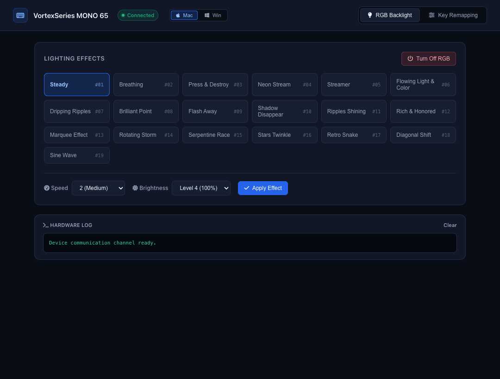

# VortexSeries MONO 65 Controller for macOS

An open-source macOS driver, CLI, and Web Dashboard for the **VortexSeries MONO 65** mechanical keyboard (`VID 0x1A2C`, `PID 0x6180`).

Developed through clean-room reverse engineering of the vendor USB HID feature protocol (`DeviceDriver.exe` / `XYUI.dll`) with Ghidra. Powered by a high-performance, single-binary **Rust** backend.



---

## Features

- **RGB Lighting Control**: Access all 19 official firmware lighting animations (*Steady, Breathing, Neon Stream, Streamer, Sine Wave, Retro Snake*, etc.) with adjustable speed (1–4) and brightness (25%–100%).
- **Quick Blackout**: One-click RGB disable ("Turn Off RGB").
- **Hardware Key Remapping**: Remap keys directly into keyboard firmware staging memory (supports up to 12 custom mappings).
- **Standalone Tilde (`~`)**: Easily map `Home` or other keys to standalone backtick/tilde (`0x35`), which is typically hidden behind `Fn + Esc` on 65% layouts.
- **1-Click Mac / Windows Mode Switch**: Instantly toggles between macOS (`Win` = Option, `Alt` = Command) and Windows layout directly from the dashboard header.
- **Ultra-Lightweight Native Backend**: Written in **Rust** using `hidapi` (direct Apple IOKit integration) and `axum` — consumes only **~11 MB RAM** and **0.00% CPU** idle.
- **Persistent Storage**: Active remaps are mirrored locally (`active_remaps.json`) for seamless recovery.

---

## Hardware Mode Note (Fn Shortcuts)

In the VortexSeries MONO 65 hardware, firmware-level OS switching can also be toggled directly via keyboard shortcuts:
- **`Fn + A`**: Windows Mode (Win = GUI, Alt = Alt)
- **`Fn + S`**: macOS Mode (Win = Option, Alt = Command)

The Web Dashboard also provides a 1-click software toggle in the header that remaps the modifier keys to match either OS instantly.

---

## Architecture & How It Works

1. **Vendor Protocol Discovery**:
   - The keyboard enumerates multiple HID interfaces. The vendor configuration channel communicates over **Usage Page `0xFF00`** via 64-byte HID Feature Reports (`Report ID: 0x07`).
   - Reverse-engineered frames:
     - `07 01 00...`: Firmware state & version read path.
     - `07 FF FF <mode-1> <speed> <bri> 00...`: Light preset configuration.
     - `07 76 54 32 10 00...` + row packet (`07 99`) + commit `07 FE DC BA`: 12-slot staging remap pipeline.
   - For full low-level documentation, see [`protocol.md`](protocol.md).

2. **Stack & Tools**:
   - **Backend**: Rust (`hidapi` + `axum` + `tokio`)
   - **Reverse Engineering Tools**: [Ghidra](https://ghidra-sre.org/) 12.1.4, Hex Fiend, IORegistryExplorer.
   - **Frontend UI**: Embedded HTML5 + CSS3 + Font Awesome 6 (zero Electron bloat).

---

## Supported Operating Systems

- **macOS**: Sonoma (14.x), Sequoia (15.x), and newer (Apple Silicon M1/M2/M3/M4 & Intel).
- *(Protocol and driver are also adaptable to Linux via standard hidraw/libusb).*

---

## Step-by-Step Installation & Getting Started

### Method 1: Rust Native Binary (Recommended — Super Fast & Light)

No Node.js required! All you need is the standard Rust compiler.

#### Step 1: Install Rust (if not installed yet)
Open Terminal and run:
```bash
curl --proto '=https' --tlsv1.2 -sSf https://sh.rustup.rs | sh
source "$HOME/.cargo/env"
```

#### Step 2: Clone the Repository & Run
```bash
# 1. Clone repository
git clone git@github-personal:rzlfathurrahman/vortexseries-mono65-macos.git
cd vortexseries-mono65-macos/rust-mono65

# 2. Compile and launch (optimized release)
cargo run --release
```

#### Step 3: Open the Dashboard
Open your browser and navigate to:
**[http://127.0.0.1:7878](http://127.0.0.1:7878)**

---

### Method 2: Node.js (Alternative / Development)

If you prefer using Node.js instead of compiling Rust:

#### Step 1: Install Node.js
If you don't have Node.js installed, the easiest way on macOS is via [Homebrew](https://brew.sh):
```bash
# Install Homebrew (if not installed)
/bin/bash -c "$(curl -fsSL https://raw.githubusercontent.com/Homebrew/install/HEAD/install.sh)"

# Install Node.js
brew install node
```
Verify installation:
```bash
node -v
npm -v
```

#### Step 2: Install Dependencies & Run
```bash
cd vortexseries-mono65-macos/legacy-node

# Install node-hid driver dependency
npm install node-hid

# Start the Node.js GUI server
node gui.js
```
Open **[http://127.0.0.1:7878](http://127.0.0.1:7878)** in your browser.

---

## Security & Privacy

- No background telemetry, tracking, or external cloud dependencies.
- Runs exclusively on local loopback interface (`127.0.0.1`).
- Only accesses the vendor configuration Usage Page (`0xFF00`), never monitoring or intercepting standard keystrokes (`Usage Page 0x01`).

---

## Legal & Disclaimer

- **Trademark Disclaimer**: "VortexSeries" and "MONO 65" are trademarks and trade names of their respective owners. This project is an independent, unofficial community tool created solely for hardware interoperability on macOS and is not affiliated with, endorsed by, or associated with VortexSeries.
- **Reverse Engineering for Interoperability**: Protocol specifications were analyzed strictly for interoperability purposes (Fair Use / Directive 2009/24/EC). No proprietary vendor binaries (`.exe`, `.dll`) or copyrighted source code are hosted or distributed in this repository.
- **Warranty Disclaimer**: This software is provided under the MIT License "as is", without warranty of any kind. Use at your own discretion.

---

## License

[MIT License](LICENSE) © 2026 Rizal Fathur Rahman.
EOF