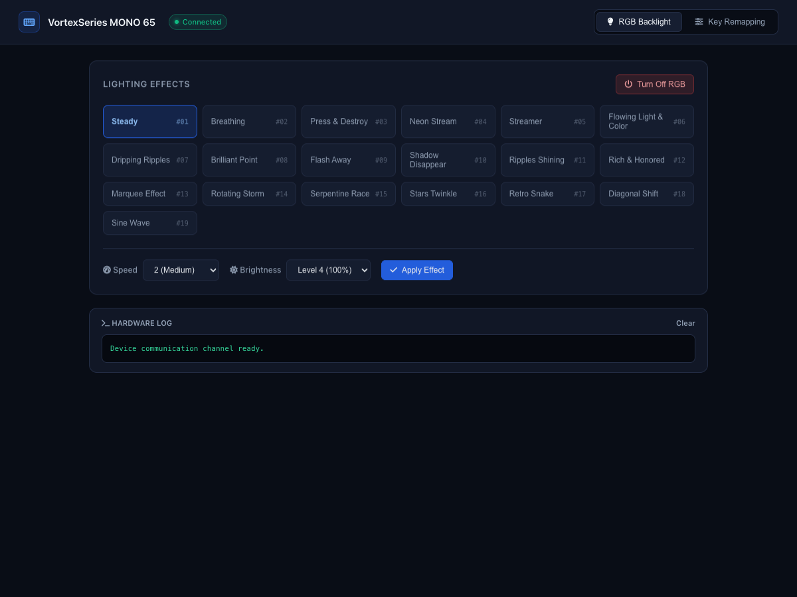

# VortexSeries MONO 65 Controller for macOS

An open-source macOS driver, CLI, and Web Dashboard for the **VortexSeries MONO 65** mechanical keyboard (`VID 0x1A2C`, `PID 0x6180`).

Developed by reverse-engineering the vendor's Windows driver (`DeviceDriver.exe` / `XYUI.dll`) with Ghidra to provide 100% native control on macOS without requiring Windows or virtual machines.



---

## Features

- **RGB Lighting Control**: Access all 19 official firmware lighting animations (*Steady, Breathing, Neon Stream, Streamer, Sine Wave, Retro Snake*, etc.) with adjustable speed (1–4) and brightness (25%–100%).
- **Quick Blackout**: One-click RGB disable ("Turn Off RGB").
- **Hardware Key Remapping**: Remap keys directly into keyboard firmware staging memory (supports up to 12 custom mappings).
- **Standalone Tilde (`~`)**: Easily map `Home` or other keys to standalone backtick/tilde (`0x35`), which is typically hidden behind `Fn + Esc` on 65% layouts.
- **Modern Hardware Dashboard**: Built with a clean, developer-focused dark interface powered by Font Awesome 6 icons (zero bloat, no external Electron overhead).
- **Persistent Storage**: Active remaps are mirrored locally (`active_remaps.json`) for seamless recovery.

---

## Mac vs Windows Mode Note

> **Note on OS Switch Mode**:
> In the VortexSeries MONO 65 firmware, OS mode switching (Windows / macOS layout mapping for `Win` and `Alt`/`Option`) is handled at the **hardware microcontroller level** via key combos:
> - **`Fn + A`**: Windows Mode (Win = GUI, Alt = Alt)
> - **`Fn + S`**: macOS Mode (Win = Option, Alt = Command)
>
> It does not require software frames over the USB lane. You can toggle this on the keyboard directly anytime.

---

## How It Works & Architecture

1. **Vendor Protocol Discovery**:
   - The keyboard enumerates multiple HID interfaces. The vendor configuration channel communicates over **Usage Page `0xFF00`** via 64-byte HID Feature Reports (`Report ID: 0x07`).
   - Reverse-engineered frames:
     - `07 01 00...`: Firmware state & version read path.
     - `07 FF FF <mode-1> <speed> <bri> 00...`: Light preset configuration.
     - `07 76 54 32 10 00...` + row packet (`07 99`) + commit `07 FE DC BA`: 12-slot staging remap pipeline.
   - For full low-level documentation, see [`protocol.md`](protocol.md).

2. **Stack & Tools**:
   - **Runtime**: Node.js (v18+)
   - **Hardware Bridge**: [`node-hid`](https://github.com/node-hid/node-hid) with `HIDAsync` for macOS IOKit integration.
   - **Reverse Engineering Tools**: [Ghidra](https://ghidra-sre.org/) 12.1.4, Hex Fiend, IORegistryExplorer.
   - **UI**: Lightweight embedded HTTP server delivering responsive HTML5 + CSS3 + Font Awesome 6.

---

## Supported Operating Systems

- **macOS**: Sonoma (14.x), Sequoia (15.x), and newer (Apple Silicon M1/M2/M3/M4 & Intel).
- *(Protocol and driver are also adaptable to Linux via standard hidraw/libusb).*

---

## Installation & Usage

### 1. Prerequisites

- macOS with Node.js installed (`node -v` >= 18)
- Keyboard plugged in via USB (cable mode)

### 2. Setup

```bash
# Clone the repository
git clone git@github-personal:rzlfathurrahman/mono65.git
cd mono65

# Install dependencies
npm install node-hid
```

### 3. Launching the Web Dashboard

```bash
node gui.js
```

Open your browser at **[http://127.0.0.1:7878](http://127.0.0.1:7878)**.

---

## Security & Privacy

- No background telemetry, tracking, or external cloud dependencies.
- Runs exclusively on local loopback interface (`127.0.0.1`).
- Only accesses the vendor HID Usage Page (`0xFF00`), never monitoring or intercepting standard keystrokes (`Usage Page 0x01`).

---

## License

MIT License. Developed for educational and hardware interoperability purposes.
